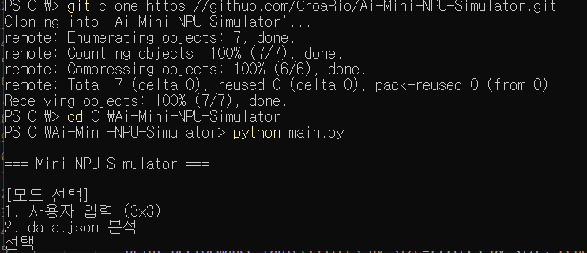
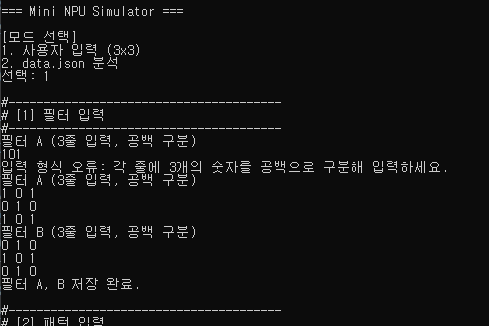
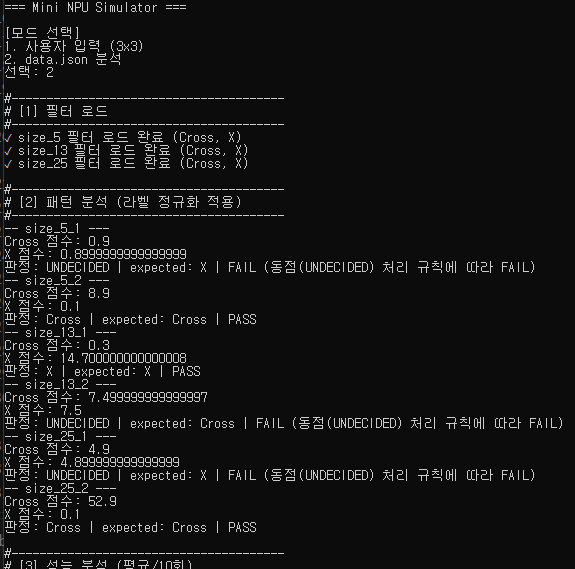
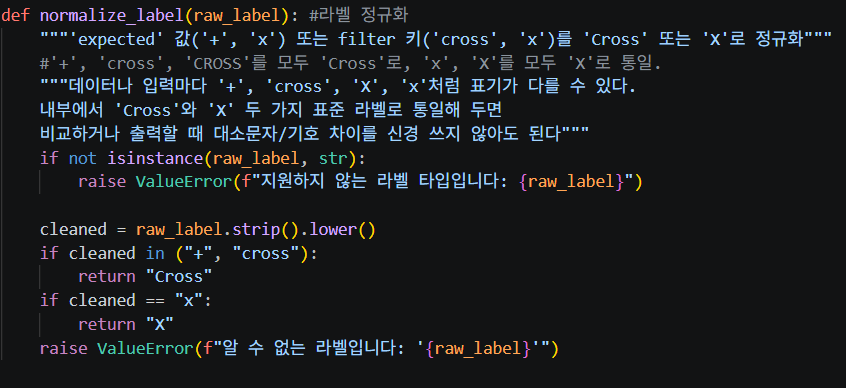
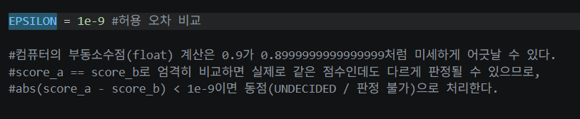
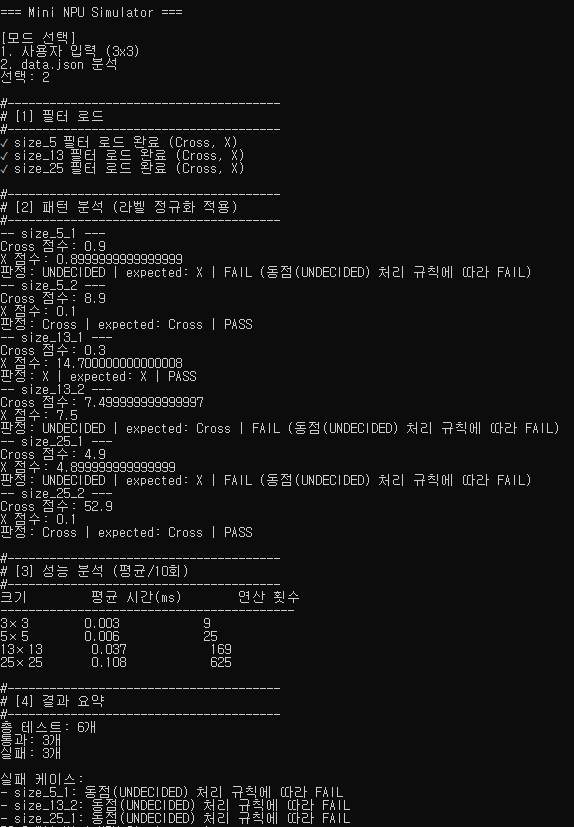

# Mini NPU Simulator

3×3부터 25×25 크기까지의 2차원 패턴과 필터를 순수 Python 이중 반복문 기반 MAC(Multiply-Accumulate) 연산으로 비교·판정하고, 크기별 연산 성능을 측정하는 콘솔 시뮬레이터입니다.

---

## 1. 실행 방법

### 실행 환경
- Python 3.8 이상 (외부 라이브러리 미사용, `json`, `os`, `re`, `time` 등 Python 표준 라이브러리만 사용)
- 작업 경로: `C:\Ai-Mini-NPU-Simulator` (`main.py`와 `data.json`을 동일 디렉터리에 배치)

### 실행 명령 및 모드 선택
```bash
python main.py
```

1. 실행 후 [모드 선택]에서 1(사용자 입력 3×3) 또는 2(data.json 분석)을 입력합니다.
2. 모드 1(사용자 입력 3×3): 필터 A(3줄), 필터 B(3줄), 패턴(3줄)을 각 줄마다 숫자를 공백으로 구분해 입력합니다. 행 수·열 수 불일치나 숫자 변환 실패 시 안내 문구를 출력하고 재입력을 유도합니다.
3. 모드 2(data.json 분석): data.json의 filters(size_5, size_13, size_25)와 patterns(size_{N}_{idx})를 불러와 판정 및 PASS/FAIL 비교, 크기별 성능 측정 표, 전체 결과 요약을 출력합니다.

* **모드 선택 화면(pics/모드-선택-화면.png):**  
  

* **모드 1(pics/모드-선택-1.png)**  
  
  
* **모드 2(pics/모드-선택-2.png)**  
  
  
## 2. 구현 요약
### 2차원 격자 및 순수 Python MAC 연산
* Grid2D 클래스로 N×N 2차원 패턴 및 필터를 float 격자로 저장하고 좌표 (row, col) 읽기/쓰기를 지원합니다.
* compute_mac 함수는 NumPy 등 외부 라이브러리 없이 for r in range(n): for c in range(n): 이중 반복문으로 동일 위치 원소 곱(pattern[r][c] * filter[r][c])을 누적 합산해 MAC 점수를 반환합니다.

### 라벨 정규화 규칙
* 내부 표준 라벨은 Cross, X 두 가지만 사용합니다.
* expected 값과 filter 키를 아래 규칙으로 정규화한 뒤 판정 및 PASS/FAIL 비교를 수행합니다.
    * '+', 'cross' → 'Cross'
    * 'x' → 'X'
### 허용오차(epsilon) 기반 점수 비교 및 동점 처리
* 부동소수점 연산 미세 오차를 반영하기 위해 EPSILON = 1e-9 기준을 적용했습니다.
* abs(score_cross - score_x) < 1e-9인 경우 동점으로 간주해 'UNDECIDED'(모드 1에서는 판정 불가)를 반환하며, PASS/FAIL 평가 시 'UNDECIDED'는 'FAIL'로 처리합니다.

### 입력 검증 및 예외 처리
* **모드 1:** 각 줄의 토큰 수와 float 변환 가능 여부를 검증하고 오류가 있으면 재입력을 요청합니다.
* **모드 2:** data.json 파일 부재/파싱 오류, size_N 필터 누락, 패턴 키의 N과 격자 크기 불일치 등이 발생해도 프로그램이 비정상 종료되지 않고 해당 케이스를 FAIL로 처리하며 사유를 남깁니다.

### 추가 기능: 1차원 배열(`길이 N^2`) 최적화 및 패턴 생성기
- **메모리 접근 단순화(2D → 1D):** `FlatGrid1D`로 `N×N` 2차원 격자를 길이 $N^2$의 1차원 리스트로 변환하고, `compute_mac_flat`에서 단일 반복문으로 동일 인덱스 원소 곱을 누적 합산하도록 구현했습니다.
- **십자가(`Cross`) & `X` 패턴 자동 생성기:** 크기 `N`과 패턴 종류(`cross` 또는 `x`)를 입력받아 `Grid2D` 패턴을 생성하며, 모드 1(3×3 패턴 자동 생성 선택) 및 성능 분석/최적화 비교에서 재활용합니다.  
  

* **코드 내 라벨 정규화(pics/라벨-정규화.png)**  
  


* **EPSILON 비교 로직(pics/EPSILON-비교-로직.png)**  
  

* **1차원 배열(`길이 N^2`) 최적화 및 패턴 생성기(pics/크기-$N$-입력시-십자가(Cross)-X-패턴-자동-생성기-연결.png)**  
  -X-패턴-자동-생성기-연결.png)


## 3. 결과 리포트
### 테스트 요약 및 실패 원인 분석
* **전체 테스트 수:** 6개 / **통과:** 3개 / **실패:** 3개
* 실패 케이스 목록:
    * size_5_1: 동점(UNDECIDED) 처리 규칙에 따라 FAIL (Cross 0.9 vs X 0.8999999999999999)
    * size_13_2: 동점(UNDECIDED) 처리 규칙에 따라 FAIL (Cross 7.499999999999997 vs X 7.5)
    * size_25_1: 동점(UNDECIDED) 처리 규칙에 따라 FAIL (Cross 4.9 vs X 4.899999999999999)
* **실패 원인 진단 (수치 비교 / 동점 규칙):**
    * 세 실패 케이스 모두 라벨 정규화(+ → Cross, x → X)나 스키마/크기 불일치 문제가 아니라, 두 필터 점수의 차이가 허용오차 1e-9 미만으로 나타나 동점(UNDECIDED) 규칙에 따라 FAIL로 판정된 사례입니다.
    * 특히 size_5_1(0.9와 0.8999999999999999), size_13_2(7.499999999999997와 7.5), size_25_1(4.9와 4.899999999999999)처럼 소수점 누적 합산 과정에서 발생하는 이진 부동소수점 표현 오차와 패턴·필터 가중치 구조가 맞물려 점수 차이가 1e-9 이내로 좁혀졌고, 동점을 UNDECIDED로 판정하는 정책에 따라 기대 라벨과 불일치(FAIL)로 집계되었습니다.

### 성능 측정 표 및 시간 복잡도 $O(N^2)$ 분석
| 크기 (N×N) | 평균 시간 (ms, 10회 반복) | 연산 횟수 (N2) |
| :---: | :---: | :---: |
| `3×3` | `0.003` | `9` | 
| `5×5` | `0.006` | `25` | 
| `13×13` | `0.031` | `169` | 
| `25×25` | `0.129` | `625` | 

* compute_mac은 N×N 격자의 모든 행(0..N-1)과 열(0..N-1)을 순회하며 원소별 곱셈과 누적을 수행하므로, 한 번의 MAC 연산에서 실행되는 반복 횟수는 $N \times N = N^2$입니다.
* 따라서 패턴 한 변의 길이가 $N$일 때 MAC 연산의 시간 복잡도는 $O(N^2)$입니다.
* 실제 측정에서도 I/O를 제외한 compute_mac 10회 반복 평균 시간이 3×3(9회) 0.003 ms, 5×5(25회) 0.006 ms, 13×13(169회) 0.031 ms, 25×25(625회) 0.129 ms로 증가하여, 격자 크기 증가에 따른 연산 횟수($N^2$) 확대가 실행 시간 증가로 이어지는 $O(N^2)$ 특성을 확인할 수 있습니다.

* **모드 2 실행 후 출력된 크기별 성능 표와 결과 요약 화면(pics/모드-2-실행-크기별-성능표-및-결과-요약-화면.png)**  
  


### 2D vs 1D(길이 N^2) 최적화 비교 결과 (동일 입력, 10회 반복 평균)

| 크기 ($N \times N$) | 2D 평균 시간 (ms) | 1D 평균 시간 (ms) | 단축 차이 (ms) |
| :---: | :---: | :---: | :---: |
| `3×3` | `0.0025` | `0.0014` | `+0.0011` |
| `5×5` | `0.0066` | `0.0019` | `+0.0046` |
| `13×13` | `0.0559` | `0.0130` | `+0.0429` |
| `25×25` | `0.1312` | `0.0572` | `+0.0740` |

- 동일한 격자와 10회 반복 기준으로 비교했을 때, `N×N` 2차원 구조를 길이 $N^2$의 1차원 배열로 평탄화하고 단일 반복문(`compute_mac_flat`)으로 연산한 경우 모든 크기(`3×3`, `5×5`, `13×13`, `25×25`)에서 평균 연산 시간이 단축되었습니다.
- 중첩 반복문과 2차원 좌표 조회 대신 연속된 1차원 리스트를 단일 루프로 순회하면서 반복 및 인덱싱 오버헤드가 줄어든 결과이며, 순수 Python 리스트 기반 연산이므로 크기 증가에 따른 전체 시간 복잡도는 동일하게 $O(N^2)$를 유지합니다.  

* **2D vs 1D(길이 N^2) 최적화 비교 결과(pics/1차원(길이 N²)-최적화-및 2D-vs-1D-성능-비교 표.png)**  
  -최적화-및%202D-vs-1D-성능-비교%20표.png)